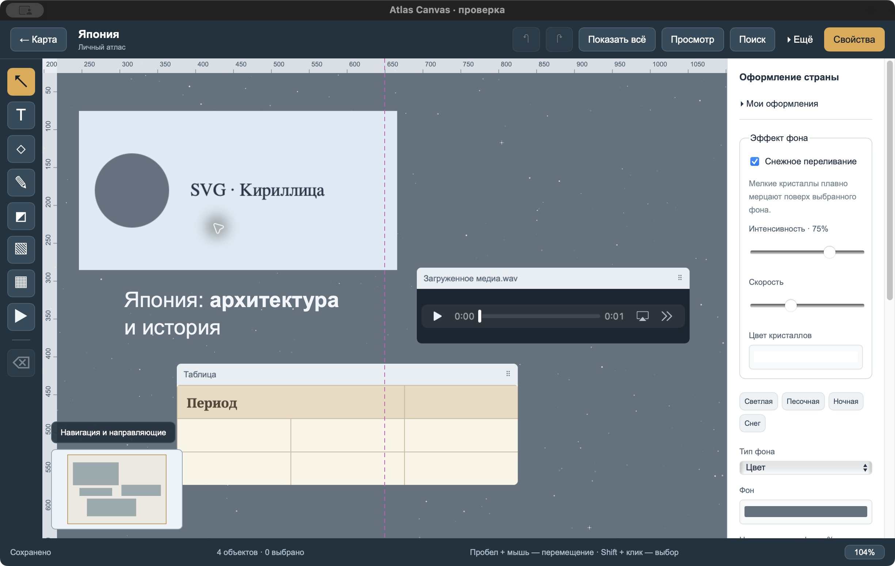

[Русский](README.md)

# Atlas Canvas

**Your personal atlas of notes, photos and memories.**

Choose a country on the map and collect everything connected with it on its own free-form canvas: travel photographs, places to explore, stories, music or future plans. Arrange your materials however you like.

[Download](https://github.com/avdasich/atlas-canvas/releases) · [Installation](docs/en/INSTALLATION.md) · [User guide](docs/en/USER_GUIDE.md) · [Keyboard shortcuts](docs/en/SHORTCUTS.md) · [Try the demo](demo/README.en.md)

## What you can do

- **Build your own atlas.** Each country has its own canvas; the map marks countries with saved content.
- **Collect materials.** Notes, photos with reversible cropping, expandable notes, drawings, tables, videos, audio and links.
- **Make it yours.** Background colors, gradients, images, fonts and snow shimmer. Glass panels and glass/sparkling text and shapes.
- **Arrange freely.** Move, resize, rotate, group and undo changes.
- **Find things quickly.** Search countries, notes, table cells and text inside folded sections.
- **Keep and share your work.** Export a canvas to PNG/PDF or save an editable atlas backup with its media.

No account is required. Your records stay on your computer. The map and imported local files work offline; downloading remote media needs a connection.

**The current app interface is in Russian.** This English documentation includes the Russian button names where needed; it does not change the app's language.

## Install

Open [Releases](https://github.com/avdasich/atlas-canvas/releases), select a published release and expand **Assets**.

| Computer                                                | Download                                                    |
| ------------------------------------------------------- | ----------------------------------------------------------- |
| Mac with an Intel processor                             | `macOS-Intel.dmg` or the corresponding ZIP                  |
| Mac with Apple Silicon, including M1/M2/M3/M4 and later | `macOS-Apple-Silicon.dmg` or the corresponding ZIP          |
| Windows x64                                             | File ending in `Windows-x64-setup.exe`                      |
| Linux x64                                               | `.deb` for compatible Debian/Ubuntu systems, or `.AppImage` |

The release workflow prepares these packages; availability depends on the selected published release. **Source code** archives are for developers, not installers.

[Step-by-step installation →](docs/en/INSTALLATION.md)

## Your first canvas

1. Open Atlas Canvas and choose a country on the map or through search.
2. Click **Текст** (Text) and write a note.
3. Use **Добавить фото** (Add photo), or drag an image from your computer.
4. Select an object and adjust it in **Свойства** (Properties).
5. Wait for **Сохранено** (Saved). You can now return to the map or close the app.

Use the mouse wheel to zoom. Drag empty space, or hold Space and drag, to pan. Press **F** to fit all objects into view.

## Explore a ready-made atlas

[Download the demonstration `.atlas`](demo/Atlas-Canvas-Iceland.atlas?raw=true), then import it through Archive and restore. It includes an Iceland cover with a short geyser video, a winter material study and a Japan notebook. Photos, video, sound and font are included for offline viewing.

[Import instructions and screenshot checklist →](demo/README.en.md)

## Back up and move your records

Changes save automatically. For a separate copy, open **Архив и восстановление → Экспорт всего атласа** (Archive and restore → Export entire atlas). Keep the resulting **`.atlas`** file on another drive, or move it to another computer.

On the other computer, choose **Открыть архив для восстановления** (Open archive to restore) and select the file. **There is no automatic synchronization between computers.** PNG/PDF share an image of your canvas; `.atlas` keeps it editable.

## Help

- [Installation and updating](docs/en/INSTALLATION.md)
- [Complete user guide](docs/en/USER_GUIDE.md)
- [Shortcuts for macOS, Windows and Linux](docs/en/SHORTCUTS.md)
- [Frequently asked questions](docs/en/USER_GUIDE.md#frequently-asked-questions)
- [Report a problem](https://github.com/avdasich/atlas-canvas/issues)

This documentation describes the 0.4 source series. Published builds may differ. Audio/video playback also depends on the codecs supported by your system.

## License

Atlas Canvas is [MIT licensed](LICENSE).

- Map data: [Natural Earth](https://www.naturalearthdata.com/about/terms-of-use/), public domain, supplied through [world-atlas](https://github.com/topojson/world-atlas).
- Noto Sans and Noto Serif: [SIL Open Font License 1.1](public/fonts/NotoSans-OFL.txt).
- Third-party notices: [public/licenses](public/licenses), also available in **О программе и лицензии** (About and licenses).
- Demo media have their own [credits and licenses](demo/SOURCES.md).

For developers and the project author

[Development](docs/en/DEVELOPMENT.md) · [Builds and releases](docs/en/RELEASE.md) · [Change history](CHANGELOG.en.md)

