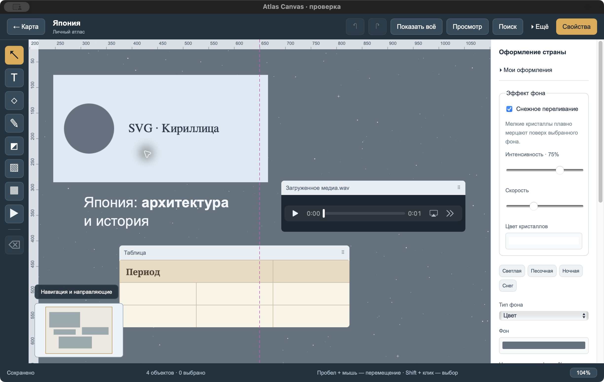

# Atlas Canvas

**Ваш личный атлас с заметками, фотографиями и воспоминаниями.**

Выберите страну на карте и соберите всё, что с ней связано, на отдельном свободном холсте: снимки из поездки, интересные места, историю, музыку или планы на будущее. Располагайте материалы так, как удобно вам.

[Скачать](https://github.com/avdasich/atlas-canvas/releases) · [Как установить](docs/INSTALLATION.md) · [Руководство](docs/USER_GUIDE.md) · [Горячие клавиши](docs/SHORTCUTS.md)

## Что можно делать

- **Собирать свой атлас.** У каждой страны свой холст. На карте видно, где уже есть записи.
- **Добавлять материалы.** Заметки, фотографии с обрезкой, раскрывающиеся сноски, рисунки, таблицы, видео, аудио и ссылки.
- **Оформлять по-своему.** Выбирать фон, цвета и шрифты, включать снежное переливание. Делать текст, фигуры и панели редактора стеклянными, добавлять блестяшки к объектам.
- **Свободно располагать объекты.** Перемещать, менять размер, поворачивать, группировать и отменять действия.
- **Быстро находить нужное.** Искать страны, заметки, текст в таблицах и свёрнутых сносках.
- **Сохранять и переносить.** Экспортировать холст в картинку или PDF, а весь атлас — в файл для резервной копии.

Приложение работает без аккаунта. Записи сохраняются на вашем компьютере; карта и добавленные с диска материалы доступны без интернета.

## Установка

Откройте [страницу загрузки](https://github.com/avdasich/atlas-canvas/releases), выберите опубликованный выпуск и раскройте **Assets** — список файлов под его описанием.

Для Windows скачайте установщик с окончанием **`-setup.exe`**. Для macOS и Linux выбирайте пакет своей системы, если он приложен к выпуску. Архив **Source code** содержит исходники, а не готовое приложение.

[Пошаговая инструкция установки →](docs/INSTALLATION.md)

## Первый холст за пару минут

1. Откройте Atlas Canvas и выберите страну на карте или через поиск.
2. Нажмите **Текст** и напишите первую заметку.
3. Добавьте фотографию кнопкой **Добавить фото** или перетащите её с компьютера.
4. Выберите объект и настройте его размер и оформление в панели **Свойства**.
5. Дождитесь надписи **Сохранено**. Теперь можно вернуться на карту или закрыть приложение.

Колесо мыши меняет масштаб. Чтобы переместиться по холсту, потяните пустое место или зажмите пробел и перетащите мышь. Клавиша **F** покажет все объекты, если вы потеряли их из виду.

[Подробнее об инструментах и оформлении →](docs/USER_GUIDE.md)

## Как сохранить копию и перенести записи

Изменения сохраняются автоматически. Для отдельной копии откройте **Архив и восстановление → Экспорт всего атласа**. Получится файл **`.atlas`** — сохраните его на другом носителе или перенесите на новый компьютер.

На другом компьютере откройте ту же панель, нажмите **Открыть архив для восстановления** и выберите этот файл.

**Записи не синхронизируются между компьютерами автоматически.** PNG и PDF подходят, чтобы поделиться изображением холста; для дальнейшего редактирования нужен файл `.atlas`.

## Нужна помощь?

- [Установка и обновление](docs/INSTALLATION.md)
- [Руководство по всем инструментам](docs/USER_GUIDE.md)
- [Сочетания клавиш для macOS, Windows и Linux](docs/SHORTCUTS.md)
- [Ответы на частые вопросы](docs/USER_GUIDE.md#частые-вопросы)
- [Сообщить об ошибке](https://github.com/avdasich/atlas-canvas/issues)

Приложение развивается. Возможности описаны для исходников версии 0.4; возможности опубликованных выпусков могут отличаться. Видео и аудио воспроизводятся в зависимости от поддержки формата вашей системой.

## Лицензия

Atlas Canvas распространяется под лицензией [MIT](LICENSE).

- Карта: данные [Natural Earth](https://www.naturalearthdata.com/about/terms-of-use/) в общественном достоянии, поставляются через пакет [world-atlas](https://github.com/topojson/world-atlas).
- Шрифты Noto Sans и Noto Serif: [SIL Open Font License 1.1](public/fonts/NotoSans-OFL.txt).
- Лицензии и уведомления сторонних компонентов находятся в [public/licenses](public/licenses) и доступны в приложении через **О программе и лицензии**.

Для разработчиков и автора проекта

[Запуск из исходников и устройство проекта](docs/DEVELOPMENT.md) · [Сборка и публикация](docs/RELEASE.md) · [История изменений](CHANGELOG.md)

