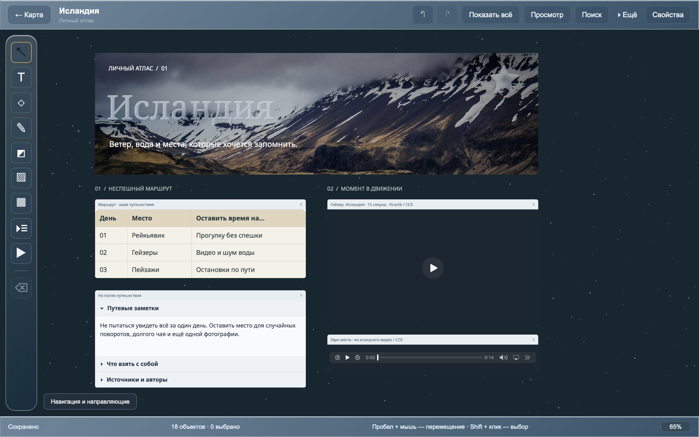

[English](README.en.md)

# Atlas Canvas

**Ваш личный атлас с заметками, фотографиями и воспоминаниями.**

Выберите страну на карте и соберите всё, что с ней связано, на отдельном свободном холсте: снимки из поездки, интересные места, историю, музыку или планы на будущее. Располагайте материалы так, как удобно вам.

[Скачать](https://github.com/avdasich/atlas-canvas/releases) · [Как установить](docs/INSTALLATION.md) · [Руководство](docs/USER_GUIDE.md) · [Горячие клавиши](docs/SHORTCUTS.md) · [Попробовать демо](demo/README.md)

## Что можно делать

- **Собирать свой атлас.** У каждой страны свой холст. На карте видно, где уже есть записи.
- **Добавлять материалы.** Заметки, фотографии с обрезкой, раскрывающиеся сноски, рисунки, таблицы, видео, аудио и ссылки.
- **Оформлять по-своему.** Выбирать фон, цвета и шрифты, включать снежное переливание. Делать текст, фигуры и панели редактора стеклянными, добавлять блестяшки к объектам.
- **Свободно располагать объекты.** Перемещать, менять размер, поворачивать, группировать и отменять действия.
- **Быстро находить нужное.** Искать страны, заметки, текст в таблицах и свёрнутых сносках.
- **Сохранять и переносить.** Экспортировать холст в картинку или PDF, а весь атлас — в файл для резервной копии.

Приложение работает без аккаунта. Записи сохраняются на вашем компьютере; карта и добавленные с диска материалы доступны без интернета.

## Установка

Откройте [страницу загрузки](https://github.com/avdasich/atlas-canvas/releases), выберите опубликованный выпуск и раскройте **Assets** — список файлов под его описанием.

| Компьютер        | Что скачать                                          |
| ---------------- | ---------------------------------------------------- |
| Mac с Intel      | `macOS-Intel.dmg`                                    |
| Mac с M1 и новее | `macOS-Apple-Silicon.dmg`                            |
| Windows x64      | `Windows-x64-setup.exe`                              |
| Linux x64        | `.deb` для совместимых Debian/Ubuntu или `.AppImage` |

Выбирайте файл для своего процессора и системы. **Source code** — исходники, а не установщик. Если нужного пакета нет, проверьте другой опубликованный выпуск. Доступность функций зависит от выбранной версии.

[Пошаговая инструкция установки →](docs/INSTALLATION.md)

Язык интерфейса можно выбрать на карте или через **Ещё → Язык** в редакторе. Доступны русский и английский; выбор сохраняется.

## Первый холст за пару минут

1. Выберите страну на карте или через поиск.
2. Добавьте заметку или фотографию. Размеры, цвета и оформление меняются в **Свойствах**.
3. Дождитесь **Сохранено**, прежде чем закрыть приложение.

Колесо мыши меняет масштаб. Чтобы переместиться по холсту, потяните пустое место или зажмите пробел и перетащите мышь. Клавиша **F** покажет все объекты, если вы потеряли их из виду.

[Подробнее об инструментах и оформлении →](docs/USER_GUIDE.md)

## Готовый пример для знакомства

[Скачайте демонстрационный `.atlas`](demo/Atlas-Canvas-Iceland.atlas?raw=true) и откройте его через **Архив и восстановление**. Внутри — Исландия с фотографией и коротким видео гейзера, зимняя палитра и блокнот идей. Все вложения включены в архив.

[Как открыть демонстрационный атлас →](demo/README.md)

## Как сохранить копию и перенести записи

Изменения сохраняются автоматически. Для отдельной копии откройте **Архив и восстановление → Экспорт всего атласа**. Получится файл **`.atlas`** — сохраните его на другом носителе или перенесите на новый компьютер.

На другом компьютере откройте ту же панель, нажмите **Открыть архив для восстановления** и выберите этот файл.

**Записи не синхронизируются между компьютерами автоматически.** PNG и PDF подходят, чтобы поделиться изображением холста; для дальнейшего редактирования нужен файл `.atlas`.

## Помощь

[Ответы на частые вопросы](docs/USER_GUIDE.md#частые-вопросы) · [Сообщить об ошибке](https://github.com/avdasich/atlas-canvas/issues)

В сообщении об ошибке укажите систему, версию приложения и шаги, после которых возникла проблема. Поддержка видео и аудио зависит от системных кодеков.

## Лицензия

Atlas Canvas распространяется под лицензией [MIT](LICENSE).

- Карта: данные [Natural Earth](https://www.naturalearthdata.com/about/terms-of-use/) в общественном достоянии, поставляются через пакет [world-atlas](https://github.com/topojson/world-atlas).
- Шрифты Noto Sans и Noto Serif: [SIL Open Font License 1.1](public/fonts/NotoSans-OFL.txt).
- Остальные уведомления — в [public/licenses](public/licenses) и разделе **О программе и лицензии**. Источники материалов демо — в [demo/SOURCES.md](demo/SOURCES.md).

Для разработчиков и автора проекта

[Разработка и выпуск](docs/DEVELOPMENT.md) · [История изменений](CHANGELOG.md)

