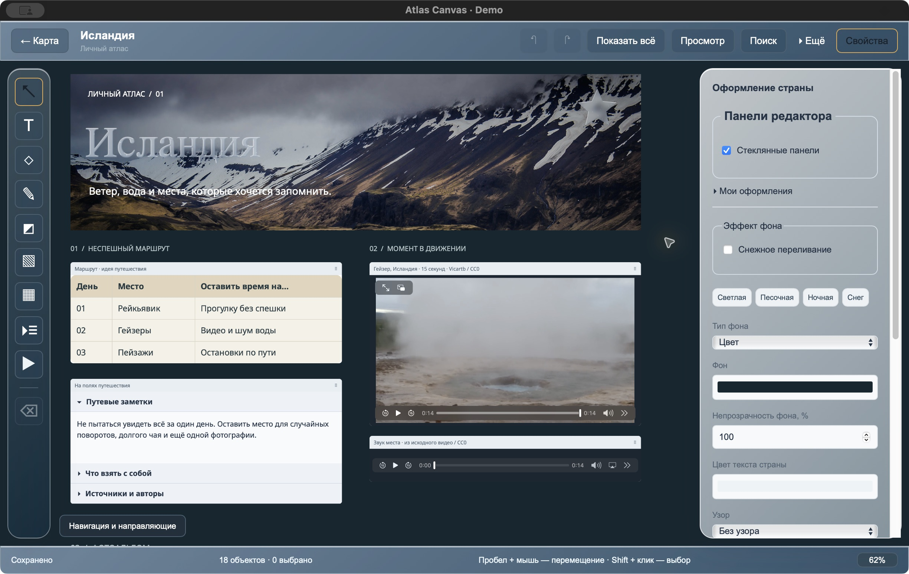

[Русский](README.md) · [Main page](../README.en.md)

# Demonstration atlas

**[Download Atlas-Canvas-Iceland.atlas](Atlas-Canvas-Iceland.atlas?raw=true)** — about 4.8 MiB, for Atlas Canvas 0.4 or newer. On GitHub's file page, use **Download raw**. New releases also include this archive.

Three ready-made canvases cover Iceland, Norway and Japan. Use them for screenshots, a short walkthrough or exploring the tools. Notes and itinerary are fictional examples. Photos and footage are open media with [source credits](SOURCES.md). The app and sample text currently use Russian; the documentation is available in both languages.

## Import

1. Export your own backup with **Архив и восстановление → Экспорт всего атласа** (Archive and restore → Export entire atlas).
2. Choose **Открыть архив для восстановления** (Open archive to restore), then select the `.atlas` file.
3. Leave **Заменить существующие страны…** (Replace existing countries…) unchecked. Existing countries are skipped. If you already use any of the three demo countries, a separate test build is the easiest way to view the demo intact.
4. Click **Восстановить** (Restore), close the panel and open Iceland.

The archive contains no global map preferences or theme-library settings. Its photos, video, audio and font work offline after import.

## Canvases

| Country                | Contents                                                                                                                                                                         |
| ---------------------- | -------------------------------------------------------------------------------------------------------------------------------------------------------------------------------- |
| **Iceland / Исландия** | Photo cover, glass title, itinerary table, 15-second geyser MP4 with sound, audio player and expandable notes. A photo workspace with originals for cropping is below the cover. |
| **Norway / Норвегия**  | Snow shimmer, glass lettering and shapes, a sparkling gold star and winter colors. This is a styling example, without photos of Norwegian locations.                             |
| **Japan / Япония**     | Mixed text styles, a table with a merged heading, a guide, a drawing and expandable sections.                                                                                    |

Iceland has **01 · Обложка** (Cover) and **02 · Фотоальбом** (Photo album) bookmarks in **Навигация и направляющие** (Navigation and guides), bottom left. F fits the lower album as well; use the first bookmark for the close cover view. Adjust the wheel zoom if your window has a different size.

## A 30–45 second walkthrough

Show the map, open Iceland, play the geyser clip and expand a note. Switch to the photo bookmark and demonstrate cropping, then undo or cancel. Open Norway, show shimmer and toggle the star's glass material. Finish in View mode.

The embedded clip is approximately 15 seconds at 1280×720, H.264/AAC. Its audio comes from the original footage; no music was added.

## Screenshot checklist

| Placeholder           | Suggested scene                                                              |
| --------------------- | ---------------------------------------------------------------------------- |
| 01 / README cover     | Iceland cover bookmark, clear selection or use View mode.                    |
| 02 / installation     | Published GitHub release with downloads for all four platforms.              |
| 03 / map              | After import, with the three demo countries marked.                          |
| 04 / editor           | Iceland cover with tools and properties visible.                             |
| 05 / text             | Japan, double-click the note and select a bold/italic passage.               |
| 06 / photos           | Iceland photo bookmark, select the large landscape.                          |
| 07 / tables           | Japan table with its merged heading and table styles panel.                  |
| 08 / media            | Iceland cover with the video playing; the link is below the photo workspace. |
| 09 / background       | Norway with the snow-shimmer settings visible.                               |
| 10 / search           | Search Iceland for «камеру»; choose the result to reveal the folded section. |
| 11 / backup           | Archive panel; preview this file without applying another import.            |
| 12 / export           | Iceland's More menu with PNG/PDF, or a saved export.                         |
| 13 / crop             | Iceland photo workspace → select landscape → crop dialog.                    |
| 14 / expandable notes | Iceland, expand one extra section and collapse the others.                   |
| 15 / materials        | Norway, glass text or star selected with its material settings.              |

[Replace screenshot placeholders](../docs/en/images/README.md). Both languages share the same image files, so one screenshot set is enough.
