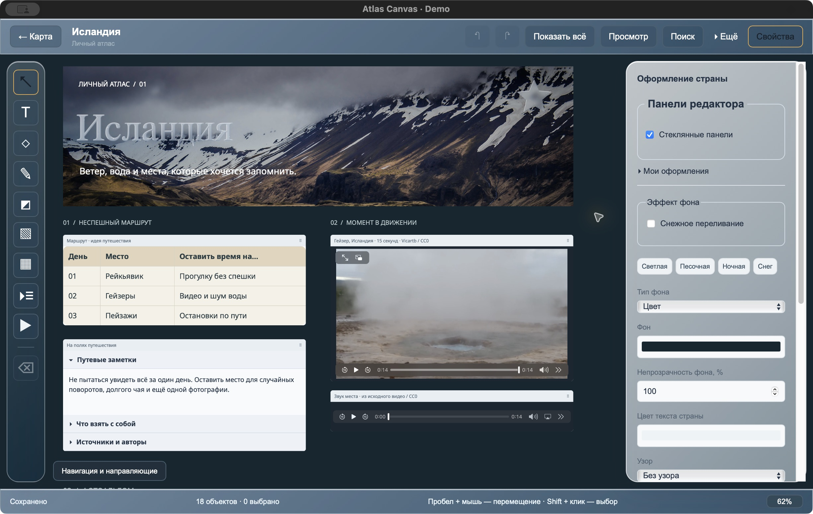

[English](README.en.md) · [Главная](../README.md)

# Демонстрационный атлас

**[Скачать Atlas-Canvas-Iceland.atlas](Atlas-Canvas-Iceland.atlas?raw=true)** — около 4,8 МБ, для Atlas Canvas 0.4 и новее. На странице файла GitHub можно нажать **Download raw**. Архив также прикладывается к новым релизам.

Внутри три холста: Исландия, Норвегия и Япония. Это готовый материал для скриншотов, записи демонстрации и знакомства с инструментами. Тексты и маршрут вымышлены; фотографии и видео — открытые материалы с указанными [источниками](SOURCES.md).

## Как открыть

1. Сохрани копию своих записей: **Архив и восстановление → Экспорт всего атласа**.
2. В той же панели нажми **Открыть архив для восстановления** и выбери `Atlas-Canvas-Iceland.atlas`.
3. При первой загрузке оставь **Заменить существующие страны…** выключенным. Уже заполненные страны тогда будут пропущены. Если они совпадают с демо, лучше открыть архив в отдельной тестовой сборке.
4. Нажми **Восстановить**, закрой панель и выбери **Исландию** на карте.

Общие настройки карты и библиотека оформлений в этот архив не включены. Для загрузки и просмотра материалов интернет не нужен.

## Где что находится

| Страна       | Содержимое                                                                                                                                                                                      |
| ------------ | ----------------------------------------------------------------------------------------------------------------------------------------------------------------------------------------------- |
| **Исландия** | Обложка с фотографией и стеклянным заголовком; маршрут в таблице; MP4 гейзера со звуком; аудиоплеер; раскрывающиеся заметки и источники. Ниже — отдельный фотоальбом с исходниками для обрезки. |
| **Норвегия** | Снежное переливание, стеклянные буквы и фигуры, мерцающая золотая звезда и зимняя палитра. Это пример оформления, без фотографий мест Норвегии.                                                 |
| **Япония**   | Заметка со смешанным начертанием, таблица с объединённым заголовком, направляющая, рисунок и раскрывающиеся разделы.                                                                            |

У Исландии есть закладки **01 · Обложка** и **02 · Фотоальбом**. Они открываются в **Навигация и направляющие** внизу слева. Клавиша F покажет также нижний альбом; для крупного вида обложки вернись к первой закладке. При другом размере окна можно немного изменить масштаб колесом мыши.

## Сценарий короткого видео

1. Покажи карту с заполненными странами и открой Исландию.
2. Перейди к закладке обложки. Запусти видео гейзера, затем раскрой **Что взять с собой**.
3. Перейди к фотоальбому, выбери снимок и покажи окно обрезки. Отмени пробную обрезку либо верни её через Cmd/Ctrl+Z.
4. Открой Норвегию: покажи переливание, выбери звезду и переключи стекло.
5. Заверши общим видом холста в режиме **Просмотр**.

Лучше записать 30–45 секунд, без ускоренного перелистывания всех панелей. Ролик гейзера длится примерно 15 секунд, 1280×720, H.264/AAC. Аудиодорожка — звук исходного видео, без добавленной музыки.

## План скриншотов для инструкции

| Заглушка            | Что открыть                                                                                       |
| ------------------- | ------------------------------------------------------------------------------------------------- |
| 01 / обложка README | Исландия → закладка обложки; снять выделение и при желании включить просмотр.                     |
| 02 / установка      | Опубликованный релиз на GitHub, список Assets с четырьмя платформами.                             |
| 03 / карта          | Карта после импорта: Исландия, Норвегия и Япония отмечены как заполненные.                        |
| 04 / редактор       | Исландия, обложка с панелью свойств и инструментами.                                              |
| 05 / текст          | Япония → двойной клик по заметке, выделить жирный или курсивный фрагмент.                         |
| 06 / фото           | Исландия → фотоальбом, выбрать большой снимок.                                                    |
| 07 / таблицы        | Япония → таблица с объединённым заголовком и панель готовых стилей.                               |
| 08 / медиа          | Исландия → обложка, запустить видео; ссылка расположена под фотоальбомом.                         |
| 09 / фон            | Норвегия → снять выделение, показать настройки снежного переливания.                              |
| 10 / поиск          | Исландия → искать «камеру»; переход раскроет свёрнутый раздел.                                    |
| 11 / архив          | Открыть панель архива; можно выбрать этот же файл для предпросмотра, не применяя импорт повторно. |
| 12 / экспорт        | Исландия → меню «Ещё», показать PNG/PDF или открыть сохранённый экспорт.                          |
| 13 / обрезка        | Исландия → фотоальбом → большой снимок → «Обрезать изображение».                                  |
| 14 / сноски         | Исландия → открыть один дополнительный раздел, остальные свернуть.                                |
| 15 / материалы      | Норвегия → выбрать стеклянный текст или звезду, показать свойства материалов.                     |

[Как подставить снимки вместо заглушек](../docs/images/README.md). Одни и те же изображения используются в русской и английской документации; повторная съёмка не нужна.
