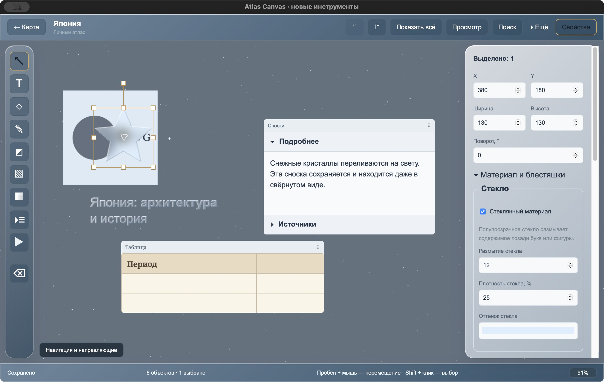
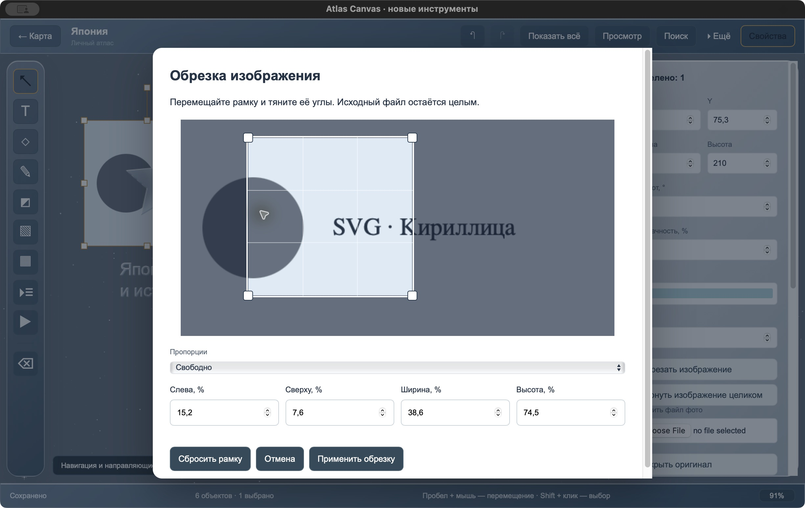

# Проверка новых инструментов 0.4

[Руководство](USER_GUIDE.md) · [Разработка](DEVELOPMENT.md) · [Изменения](../CHANGELOG.md)

Проверено 4 ноября 2026 на macOS, в отдельном приложении **Atlas Canvas Features Check** с identifier `com.m1.atlas-canvas.features-04`. Данные основной программы и прежних QA-приложений не использовались для записи. Публикация, push и тег не выполнялись.

## Что проверено

| Область             | Результат                                                                                                                                                                                                                        |
| ------------------- | -------------------------------------------------------------------------------------------------------------------------------------------------------------------------------------------------------------------------------- |
| Обрезка             | Рамка меняет размер и перемещается мышью; проценты задают область. Применение, отмена через Cmd+Z, повтор, выход через Esc без изменений и восстановление полного снимка работают. Исходный asset ID сохраняется.                |
| Сноски              | Создание двух разделов, ввод текста, сворачивание и поиск по скрытому слову. Переход к результату раскрывает нужный раздел.                                                                                                      |
| Просмотр            | Свёрнутый раздел раскрывается в read-only; возврат к редактированию сохраняет прежнее состояние.                                                                                                                                 |
| Материалы           | Стекло и мерцание одновременно назначены заметке и звезде. Фигура размывает снимок или таблицу под собой; буквы ограничивают эффект своей маской.                                                                                |
| Панели              | Стеклянный режим сохраняется для страны. Новые объекты и «Показать всё» учитывают место, занятое панелями.                                                                                                                       |
| Выбор и перемещение | Стеклянная фигура выбирается и перетаскивается поверх HTML-таблицы. Лишнее выделение HTML-страницы при drag исправлено. После переключателя свойств клик по фигуре возвращает клавиатурное управление холсту: Esc снимает выбор. |
| Экспорт             | Через системный диалог сохранены PNG, PDF и полный `.atlas`. В PNG/PDF видны выбранная часть снимка, раскрытый текст, стеклянная фигура и статичные кристаллы.                                                                   |
| Повторный запуск    | После Cmd+Q и запуска все 6 объектов, обрезка, содержимое сносок, стекло и мерцание сохранились.                                                                                                                                 |
| SQLite и архив      | Копия тестовой базы: `integrity_check = ok`, `user_version = 2`, сцена 392 формата 5. CRC экспортированного ZIP-архива проходит.                                                                                                 |

## Автоматические проверки

- 45 frontend/domain-тестов: в том числе сохранение положения пикселей при обрезке повёрнутого/масштабированного изображения, сброс и Undo; границы рамки; поиск по свёрнутому содержимому; черновики; миграция 2/3/4 → 5; порядок видимых объектов и невидимых hit-прокси.
- 15 Rust-тестов: в том числе сохранение/повторное чтение новых полей, отказ от некорректной обрезки/повторяющихся разделов/недопустимых материалов без потери прежней сцены; перенос формата 5 в другую базу с новым asset ID и неизменными байтами оригинала.
- TypeScript/Vite build, форматирование Prettier/rustfmt и `git diff --check`.
- Собран отдельный macOS `.app`. Список зависимостей не расширялся.

## Практические ограничения

Windows и Linux требуют сборки в Actions и ручного запуска пакетов на соответствующих ОС. Локальная проверка macOS не подтверждает работу всех WebView/GPU на этих платформах.

Стекло использует прозрачность, размытие и светлые грани; это не полный движок преломления Apple Liquid Glass. В PNG/PDF CPU-размытие может немного отличаться от CSS WebView. Мерцание в PNG/PDF статичное; `.atlas` сохраняет настройки анимации. При системном уменьшении движения анимация отключается.

Перед обновлением сохраните `.atlas`: 0.4 читает старые сцены, но 0.2/0.3 не открывают формат 5. Основной identifier `com.m1.tauri-app` и SQLite-схема не менялись.
