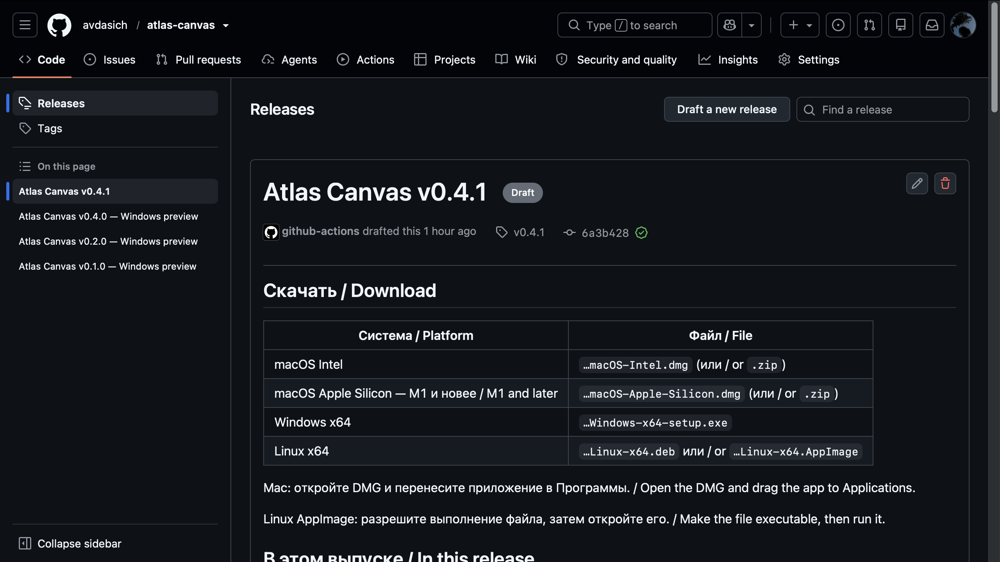

[English](en/INSTALLATION.md)

# Установка и обновление

[Главная](../README.md) · [Руководство](USER_GUIDE.md)

## Скачать приложение

1. Откройте [страницу загрузки Atlas Canvas](https://github.com/avdasich/atlas-canvas/releases).
2. Выберите опубликованный выпуск.
3. Под его описанием раскройте **Assets** — список файлов для скачивания.
4. Скачайте пакет для своей операционной системы.

**Source code (zip)** и **Source code (tar.gz)** — исходники для разработчиков. Для обычной установки они не нужны.

## Windows

1. Скачайте файл с окончанием **`-setup.exe`**.
2. Откройте его и следуйте подсказкам установщика.
3. После установки запустите **Atlas Canvas**.

Установщик новых выпусков включает WebView2 для установки без интернета.

Версия установщика рассчитана на Windows x64. Пакет пока не подписан цифровой подписью, поэтому Windows может показать предупреждение об издателе. Скачивайте приложение со страницы проекта, указанной выше.

## macOS

Откройте ** → Об этом Mac** и посмотрите процессор:

| Процессор                    | Пакет                   |
| ---------------------------- | ----------------------- |
| Intel                        | **macOS-Intel**         |
| Apple M1, M2, M3, M4 и новее | **macOS-Apple-Silicon** |

Откройте **`.dmg`**, перенесите **Atlas Canvas.app** в **Программы** и запустите оттуда.

У приложения локальная подпись для проверки целостности. Developer ID и нотарификации Apple пока нет, поэтому macOS может блокировать первый запуск.

Если вы скачали пакет со страницы проекта и доверяете ему, попробуйте открыть приложение один раз, затем перейдите в **Системные настройки → Конфиденциальность и безопасность → Всё равно открыть** и следуйте подсказкам системы. [Объяснение Apple](https://support.apple.com/ru-ru/102445).

При сообщении «приложение повреждено» не используйте Mac-пакет версии 0.4.1: у него некорректная подпись бандла. Скачайте более новую сборку или [соберите приложение локально](DEVELOPMENT.md). Локальная подпись не гарантирует разрешение запуска скачанного приложения: для полноценного публичного выпуска нужны Developer ID и нотарификация.

## Linux

- **`.deb`** — откройте установщиком пакетов совместимой системы Debian/Ubuntu.
- **`.AppImage`** — разрешите выполнение в свойствах файла и откройте. В терминале: `chmod +x имя-файла.AppImage`, затем `./имя-файла.AppImage`.

Пакеты рассчитаны на **x64**, базовая система сборки — Ubuntu 22.04. Другим дистрибутивам могут понадобиться дополнительные зависимости или отдельная сборка. Если нужного пакета нет в Assets, в выбранном выпуске он ещё не опубликован.

## Обновить приложение

1. В текущей версии откройте **Архив и восстановление**.
2. Нажмите **Экспорт всего атласа** и сохраните файл `.atlas`.
3. Закройте приложение.
4. Скачайте и установите новую версию для своей системы.
5. Откройте несколько стран и проверьте свои записи.

Копию `.atlas` сохраните до проверки обновления. Если вы переходите из отдельной тестовой программы, перенесите записи через этот файл: у тестовой и основной программ могут быть разные хранилища.

## Если не получается

**На странице нет файлов для моей системы.** В этом выпуске пакет ещё не приложен. Выберите другой опубликованный выпуск или дождитесь готовой сборки.

**Ссылка открывается у автора, но у меня — ошибка.** Возможно, выпуск пока сохранён как черновик. Для скачивания нужна ссылка на опубликованный выпуск.

**После установки нет моих записей.** Проверьте, что вы открыли нужную программу. Для переноса с другого компьютера или из тестовой версии используйте **Архив и восстановление → Открыть архив для восстановления** и сохранённый файл `.atlas`.

Если проблема осталась, [сообщите об ошибке](https://github.com/avdasich/atlas-canvas/issues): укажите систему, версию приложения и текст сообщения. При необходимости приложите снимок экрана без личных заметок.

[Открыть первый холст →](USER_GUIDE.md#первый-холст)
