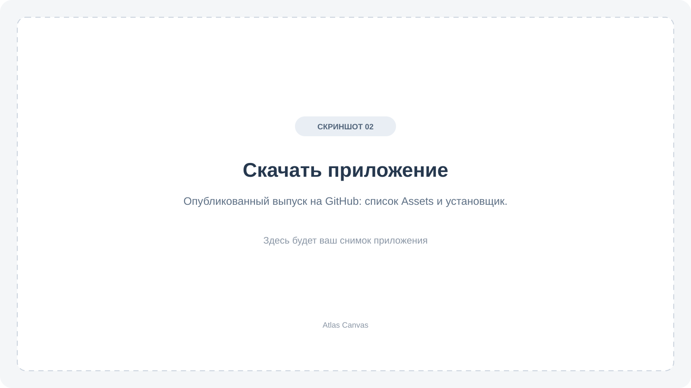

# Установка и обновление

[Главная](../README.md) · [Руководство](USER_GUIDE.md)

## Скачать приложение

1. Откройте [страницу загрузки Atlas Canvas](https://github.com/avdasich/atlas-canvas/releases).
2. Выберите опубликованный выпуск.
3. Под его описанием раскройте **Assets** — список файлов для скачивания.
4. Скачайте пакет для своей операционной системы.

<!-- Скриншот 02: страница опубликованного выпуска, раскрытые Assets и установщик. -->

**Source code (zip)** и **Source code (tar.gz)** — исходники для разработчиков. Для обычной установки они не нужны.

## Windows

1. Скачайте файл с окончанием **`-setup.exe`**.
2. Откройте его и следуйте подсказкам установщика.
3. После установки запустите **Atlas Canvas**.

Версия установщика рассчитана на Windows x64. Пакет пока не подписан цифровой подписью, поэтому Windows может показать предупреждение об издателе. Скачивайте приложение со страницы проекта, указанной выше.

## macOS

Если к выпуску приложен ZIP для macOS, распакуйте его и перенесите **Atlas Canvas.app** в папку **Программы**. Затем откройте приложение.

Если пакет для macOS не приложен, готового приложения для этой системы в выбранном выпуске нет.

## Linux

Если к выпуску приложен файл **`.deb`**, откройте его через установщик пакетов вашей системы. Такой пакет подходит для совместимых дистрибутивов, например Ubuntu; для других систем может понадобиться отдельная сборка.

## Обновить приложение

1. В текущей версии откройте **Архив и восстановление**.
2. Нажмите **Экспорт всего атласа** и сохраните файл `.atlas`.
3. Закройте приложение.
4. Скачайте и установите новую версию для своей системы.
5. Откройте несколько стран и проверьте свои записи.

Копию `.atlas` сохраните до проверки обновления. Если вы переходите из отдельной тестовой программы, например **Atlas Canvas QA 03**, перенесите записи через этот файл: у тестовой и основной программ могут быть разные хранилища.

## Если не получается

**На странице нет файлов для моей системы.** В этом выпуске пакет ещё не приложен. Выберите другой опубликованный выпуск или дождитесь готовой сборки.

**Ссылка открывается у автора, но у меня — ошибка.** Возможно, выпуск пока сохранён как черновик. Для скачивания нужна ссылка на опубликованный выпуск.

**После установки нет моих записей.** Проверьте, что вы открыли нужную программу. Для переноса с другого компьютера или из тестовой версии используйте **Архив и восстановление → Открыть архив для восстановления** и сохранённый файл `.atlas`.

Если проблема осталась, [сообщите об ошибке](https://github.com/avdasich/atlas-canvas/issues): укажите систему, версию приложения и текст сообщения. При необходимости приложите снимок экрана без личных заметок.

[Открыть первый холст →](USER_GUIDE.md#первый-холст)
