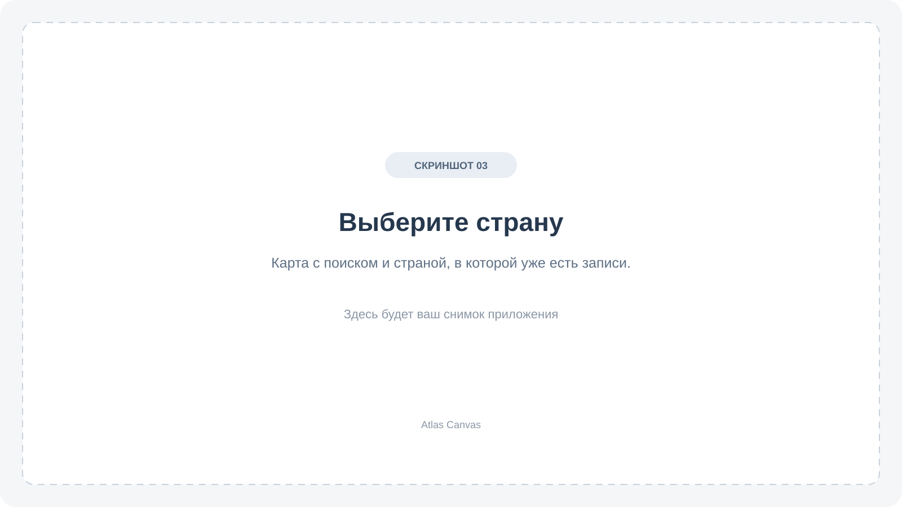
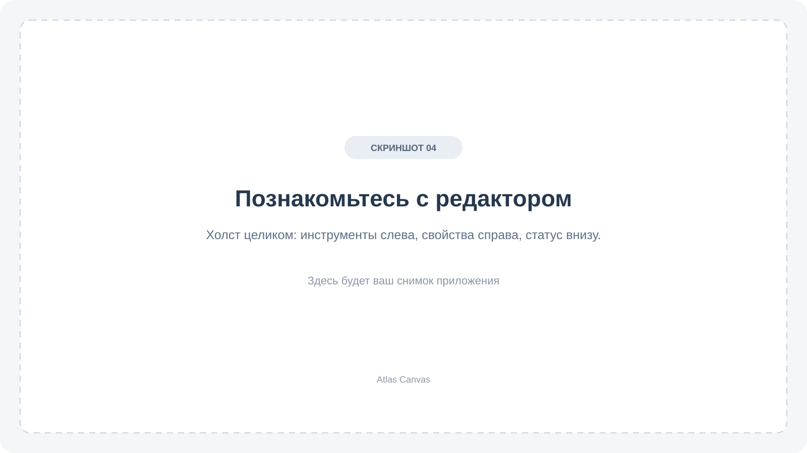
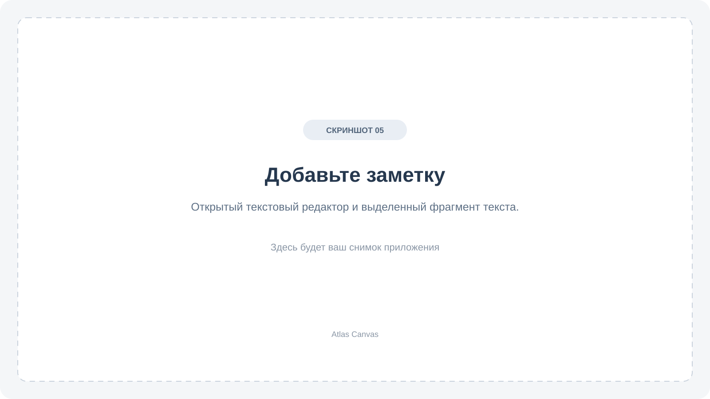
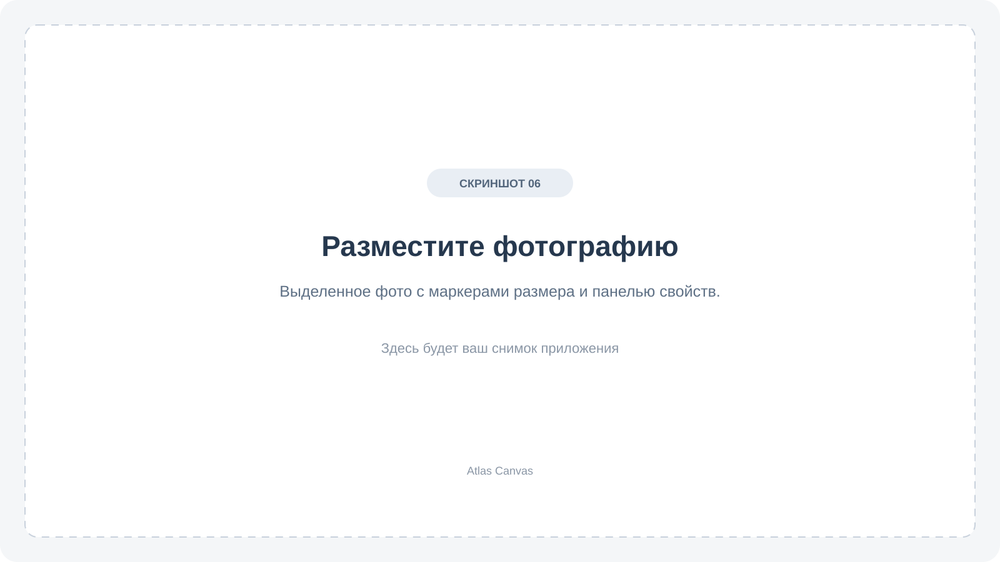
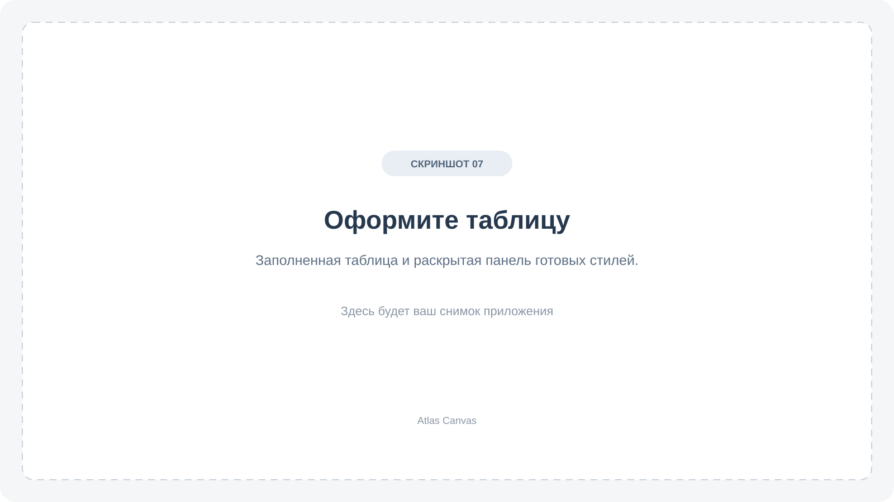
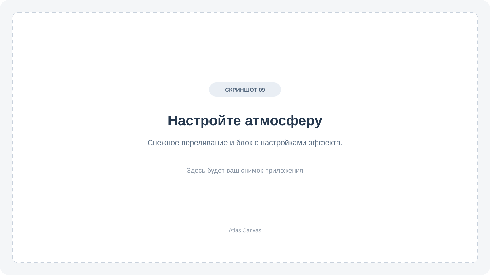
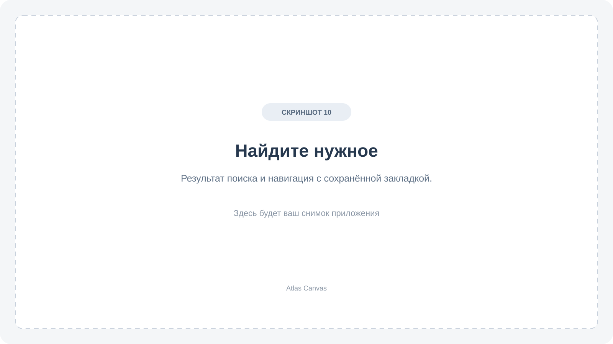
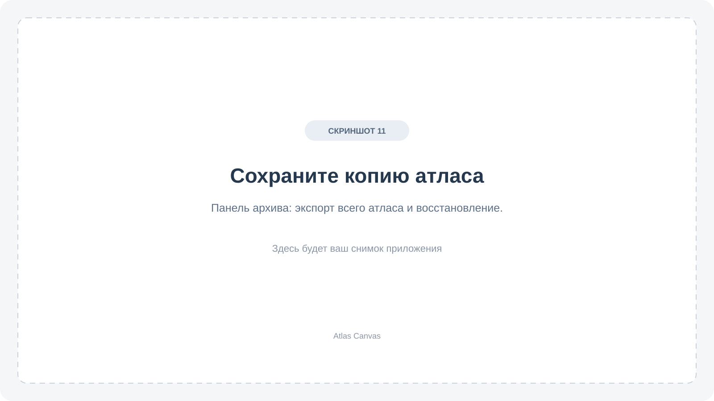

# Как пользоваться Atlas Canvas

[Главная](../README.md) · [Установка](INSTALLATION.md) · [Горячие клавиши](SHORTCUTS.md)

Atlas Canvas помогает собирать материалы о странах на свободных холстах. Можно начать с одной заметки или фотографии, а затем постепенно дополнять свой атлас.

## Содержание

- [Первый холст](#первый-холст)
- [Карта и выбор страны](#карта-и-выбор-страны)
- [Как устроен редактор](#как-устроен-редактор)
- [Перемещение и работа с объектами](#перемещение-и-работа-с-объектами)
- [Текст и фотографии](#текст-и-фотографии)
- [Фигуры и рисунки](#фигуры-и-рисунки)
- [Таблицы](#таблицы)
- [Видео, аудио и ссылки](#видео-аудио-и-ссылки)
- [Фон и снежное переливание](#фон-и-снежное-переливание)
- [Поиск и навигация](#поиск-и-навигация)
- [Сохранение и резервная копия](#сохранение-и-резервная-копия)
- [Экспорт в картинку или PDF](#экспорт-в-картинку-или-pdf)
- [Частые вопросы](#частые-вопросы)

## Первый холст

1. Откройте приложение и выберите страну — например, Казахстан.
2. Нажмите **Текст** на панели слева. Дважды нажмите на появившуюся заметку и введите текст.
3. Нажмите **Готово** или Cmd+Enter на macOS / Ctrl+Enter на Windows и Linux.
4. Добавьте фото: нажмите **Добавить фото** или перетащите изображение с компьютера на холст.
5. Расположите материалы и дождитесь надписи **Сохранено** внизу окна.

Можно вернуться на карту и выбрать другую страну: у неё будет отдельный холст.

## Карта и выбор страны

<!-- Скриншот 03: карта, поиск страны и отметка страны с записями. -->

Нажмите на страну, чтобы открыть её холст. Если небольшую страну трудно найти на карте, воспользуйтесь поиском по русскому или английскому названию либо списком **Все страны**.

В результатах поиска нажатие на название открывает холст, а **Показать на карте** приближает нужное место. Страны с записями выделяются общим цветом.

Колесо мыши приближает и отдаляет карту, перетаскивание перемещает её. Кнопка **Сброс вида** возвращает общий вид. Цвета можно изменить через **Оформление карты**.

## Как устроен редактор

<!-- Скриншот 04: редактор целиком; отметить верхнюю панель, инструменты, свойства и сохранение. -->

- **Слева** — инструменты: выбор, текст, фигуры, рисование, фото, таблицы и медиа.
- **Справа** — свойства выбранного объекта. Если ничего не выбрано, здесь настраивается фон страны.
- **Сверху** — возврат на карту, отмена и повтор действий, поиск и меню **Ещё**.
- **Снизу** — состояние сохранения, число объектов и масштаб.

Наведите мышь на кнопку, чтобы увидеть подсказку. **Свойства** сворачивает правую панель. **Просмотр** скрывает инструменты и позволяет рассмотреть композицию без редактирования; Esc возвращает редактор.

## Перемещение и работа с объектами

| Что нужно сделать             | Как                                                       |
| ----------------------------- | --------------------------------------------------------- |
| Приблизить или отдалить холст | Прокрутить колесо мыши                                    |
| Переместиться по холсту       | Потянуть пустое место или зажать пробел и перетащить мышь |
| Увидеть всё содержимое        | Нажать **Показать всё** или клавишу **F**                 |
| Вернуть масштаб 100%          | Нажать процент внизу или клавишу **1**                    |
| Выбрать объект                | Нажать на него                                            |
| Выбрать несколько             | Удерживать Shift и нажимать на объекты                    |
| Выбрать рамкой                | Зажать Shift и протянуть рамку по пустому месту           |
| Снять выделение               | Нажать Esc                                                |

Фото, фигуры и заметки можно перемещать мышью. **Таблицу или плеер тяните за заголовок.** У выделенных фото и фигур есть маркеры размера и поворота; точные значения также доступны в свойствах справа.

Для отмены нажмите стрелку **Отменить** вверху или Cmd/Ctrl+Z. Повтор возвращает отменённое действие. История отмены действует во время работы с открытым холстом.

### Порядок, группы и скрытие

В свойствах можно переместить объект на передний или задний план, дублировать, заблокировать и сгруппировать несколько объектов. Группа помогает двигать их вместе. Блокировка защищает от случайного перемещения.

Раздел **Слои** показывает список объектов и позволяет скрывать их. Скрытый объект остаётся в атласе. Если хотите автоматически разнести материалы, используйте **Разложить без пересечений** в меню по правой кнопке мыши; действие можно отменить.

Выбранные объекты можно копировать и вставлять в другую страну в пределах одного запуска приложения.

## Текст и фотографии

### Заметка

1. Нажмите **Текст** или клавишу **T**.
2. Дважды нажмите на заметку и введите текст. Enter добавляет новую строку.
3. Завершите ввод кнопкой **Готово** или Cmd/Ctrl+Enter. Esc отменяет текущий ввод.

<!-- Скриншот 05: открытая заметка, выделенный фрагмент и кнопки форматирования. -->

В свойствах меняются шрифт, размер, цвет, выравнивание и фон заметки. Чтобы выделить только часть текста жирным, курсивом или подчёркиванием, сначала выделите этот фрагмент в редакторе. Там же можно добавить список или ссылку. Для открытия ссылки в готовой заметке удерживайте Cmd/Ctrl и нажмите на неё.

Встроены шрифты Noto Sans и Noto Serif. Через **Добавить локальный шрифт** можно выбрать свой файл шрифта.

### Фотография

1. Нажмите **Добавить фото** и выберите одно или несколько изображений. Можно перетащить их прямо на холст.
2. Выберите фото, переместите его и потяните за маркеры, чтобы изменить размер.
3. При необходимости настройте поворот и прозрачность справа.

<!-- Скриншот 06: выделенная фотография с маркерами размера и её свойствами. -->

Для замены выберите фото и используйте **Заменить файл фото** в свойствах. Там же можно открыть оригинал или показать его в папке. Перемещение исходного файла на компьютере не ломает уже импортированную фотографию.

Поддерживаются PNG, JPEG, WebP, GIF и SVG. GIF отображается без анимации, SVG при добавлении превращается в картинку и может потерять сложные эффекты.

## Фигуры и рисунки

Откройте **Фигуры** на левой панели и выберите нужный вариант: прямоугольник, квадрат, круг, эллипс, звезду, линию или стрелку. Для создания мышью включите **Рисовать протягиванием**.

**Карандаш** позволяет рисовать от руки. Цвет, толщина и прозрачность доступны на панели рисования; дополнительные свойства выбранного штриха — справа. **Ластик** удаляет целый штрих. Если удалили лишнее, отмените действие.

## Таблицы

1. Нажмите **Добавить таблицу** и укажите число строк и столбцов.
2. Нажмите на ячейку и введите текст.
3. В свойствах добавляйте строки и столбцы, меняйте их размеры, фон, границы и оформление текста.

<!-- Скриншот 07: заполненная таблица и её свойства, раскрытые стили. -->

В разделе **Стили таблицы** есть готовые варианты. Свой стиль можно сохранить под названием и применять к другим таблицам.

Для объединения выберите ячейку и нажмите **Объединить с ячейкой справа** или **Объединить с ячейкой снизу**. **Разделить ячейки** возвращает сетку. Текст перекрытых ячеек сохраняется и появится после разделения.

Таблицу можно перемещать за заголовок. Если длинный текст не помещается, увеличьте высоту строки. Формулы и расчёты не поддерживаются.

## Видео, аудио и ссылки

<!-- Скриншот 08: видео, аудиоплеер и карточка ссылки на одном холсте. -->

Откройте меню **Медиа и ссылки**, выберите видео или аудио и укажите файл с компьютера. Для запуска нажмите кнопку воспроизведения в появившемся плеере. Добавленные файлы доступны без интернета.

Чтобы сохранить веб-страницу, добавьте ссылку с названием и адресом. Она откроется в браузере после нажатия. Для просмотра самой страницы нужен интернет.

В этом же меню можно скачать изображение, видео или аудио по прямому адресу файла. Ссылка на страницу видеосервиса не равна ссылке на видеофайл и может не подойти для скачивания.

У выбранного видео или аудио можно **Заменить файл медиа**, открыть оригинал или показать его в папке. Если файл не воспроизводится, попробуйте другой формат: например, MP4 для видео или MP3/WAV для аудио.

## Фон и снежное переливание

1. Нажмите Esc, чтобы снять выделение.
2. Откройте **Свойства → Оформление страны**.
3. Выберите готовый вариант или настройте цвет, градиент либо фоновую картинку.
4. При желании добавьте узор и выберите основной шрифт страны.

<!-- Скриншот 09: снежный фон и отдельный блок с переключателем и настройками эффекта. -->

**Снежное переливание** включается отдельно в блоке **Эффект фона**. Интенсивность, скорость и цвет кристаллов настраиваются. Пресет **Снег** быстро подбирает подходящую основу, но эффект можно использовать и с другим фоном.

В **Мои оформления** сохраняйте понравившуюся тему под именем, чтобы применять её в других странах. Изменение фона одной страны не меняет остальные. Светлая и тёмная темы самого интерфейса переключаются на главном экране.

## Поиск и навигация

Кнопка **Поиск** или Cmd/Ctrl+F ищет текст в заметках, таблицах и ссылках открытой страны. Нажмите на результат, чтобы перейти к объекту.

<!-- Скриншот 10: поиск по заметке и раскрытая панель навигации с закладкой. -->

Внизу слева откройте **Навигация и направляющие**. Здесь можно включить мини-карту и линейки, добавить направляющие для ровного расположения объектов. Введите название и нажмите **Запомнить вид**, чтобы сохранить удобный ракурс холста как закладку.

Если потеряли материалы из виду, нажмите **F**. В меню **Ещё** также есть **Показать выделенное** и **Предыдущий вид**.

## Сохранение и резервная копия

Изменения сохраняются автоматически. Перед закрытием убедитесь, что внизу написано **Сохранено**. При ошибке сохранения проверьте сообщение и повторите попытку.

Для копии, которую можно хранить отдельно или перенести на другой компьютер:

1. Откройте **Архив и восстановление** на карте или через **Ещё** в редакторе.
2. Выберите **Экспорт всего атласа**. Для одной страны — **Экспорт этой страны**.
3. Укажите, куда сохранить файл **`.atlas`**.

<!-- Скриншот 11: панель архива с кнопками экспорта и восстановления. -->

Чтобы восстановить записи, в этой панели нажмите **Открыть архив для восстановления**, выберите `.atlas`, проверьте список стран и нажмите **Восстановить**. Существующие страны по умолчанию пропускаются. Флажок замены включайте, только если хотите заменить их содержимое копией из архива.

Для возврата к прежнему сохранённому состоянию одной страны откройте **Ещё → Версии холста** и выберите нужную версию.

**На новом компьютере ваши записи не появятся сами:** перенесите их через `.atlas`. Такой файл содержит и материалы, и их расположение, поэтому подходит для дальнейшего редактирования.

## Экспорт в картинку или PDF

1. Откройте **Ещё** в редакторе.
2. Выберите нужный вариант экспорта.
3. Укажите место и имя файла.

<!-- Скриншот 12: раскрытое меню «Ещё» с вариантами PNG и PDF. -->

| Вариант                   | Когда использовать                                |
| ------------------------- | ------------------------------------------------- |
| **PNG всего холста**      | Сохранить всю композицию картинкой                |
| **PNG видимой области**   | Сохранить только то, что сейчас видно             |
| **PNG выбранной таблицы** | Поделиться отдельной таблицей                     |
| **PDF всего холста**      | Получить документ на одной странице               |
| **PDF по страницам**      | Разделить длинную композицию на несколько страниц |

В картинке и PDF видео и аудио показаны карточками, а анимация фона — неподвижным кадром. Чтобы передать редактируемый атлас вместе с файлами, используйте **`.atlas`**.

## Частые вопросы

**Где мои записи?** Они хранятся на компьютере, где вы работаете. Для переноса между компьютерами нужен экспорт `.atlas`.

**Можно без интернета?** Да: карта, редактирование и материалы, добавленные с диска, работают без сети. Для внешних страниц и скачивания новых файлов интернет нужен.

**Объекты исчезли с экрана.** Нажмите **F** и проверьте, не скрыты ли они в разделе **Слои**.

**Как отменить случайное удаление?** Нажмите Cmd/Ctrl+Z, пока открыт тот же холст. Для более раннего состояния проверьте **Версии холста**.

**После обновления пусто.** Возможно, вы открыли другую тестовую или основную программу. Импортируйте сохранённый `.atlas` — подробнее в [инструкции обновления](INSTALLATION.md#обновить-приложение).

**Видео или аудио не играет.** Поддержка зависит от формата файла и вашей системы. Попробуйте другой формат или замените файл через свойства.

**Как сообщить об ошибке?** Создайте [обращение на GitHub](https://github.com/avdasich/atlas-canvas/issues). Напишите, что делали, что ожидали увидеть и что произошло. Укажите систему и версию приложения; при необходимости приложите снимок без личных данных.
