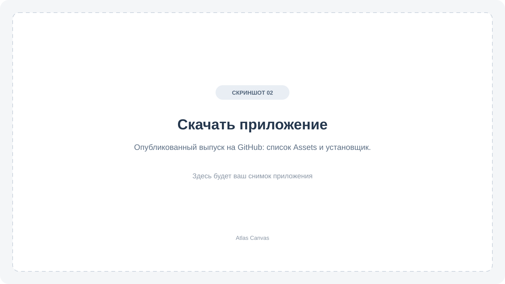

[Русский](../INSTALLATION.md) · [Main page](../../README.en.md) · [User guide](USER_GUIDE.md)

# Installation and updates

## Download

1. Open [Atlas Canvas Releases](https://github.com/avdasich/atlas-canvas/releases).
2. Choose a published release and expand **Assets** below its description.
3. Download the package for your operating system and processor.

**Source code (zip/tar.gz)** contains source files, not a ready-to-run app.

## Windows

Download the file ending in **`Windows-x64-setup.exe`** and follow the installer. It targets 64-bit Windows and includes the WebView2 installer for offline installation. Current packages are unsigned, so the publisher may appear as unknown.

## macOS

Use **Apple menu → About This Mac** to identify your processor.

| What the Mac shows                  | Package                 |
| ----------------------------------- | ----------------------- |
| Intel processor                     | **macOS-Intel**         |
| Apple chip such as M1, M2, M3 or M4 | **macOS-Apple-Silicon** |

Open the **`.dmg`**, drag **Atlas Canvas.app** to **Applications**, then open it there. A matching ZIP is also provided: unzip it and move the `.app` to Applications. Choose one format, not both.

These builds are not yet signed/notarized with an Apple Developer identity. macOS may request approval to open the app. Download it from the project's official release page.

## Linux

- **`.deb`**: use your system's package installer on a compatible Debian/Ubuntu distribution.
- **`.AppImage`**: make it executable in the file's permissions and open it. From a terminal, use `chmod +x filename.AppImage`, followed by `./filename.AppImage`, substituting the downloaded filename.

Linux packages target **x64**. Builds use Ubuntu 22.04 as their baseline; older systems and other distributions may need additional system dependencies or a separate build. AppImage availability is not a promise that every Linux distribution is supported.

## Update

1. In the current app, open **Архив и восстановление → Экспорт всего атласа** (Archive and restore → Export entire atlas).
2. Keep the `.atlas` backup, then close the app.
3. Install the new version for the same platform.
4. Reopen a few countries and check your records before discarding the backup.

Regular updates retain the production identifier and data location. Separate QA/test apps have their own storage; transfer their records using `.atlas`.

Version 0.4 uses scene format 5. Older 0.2/0.3 apps cannot open these scenes. Keep a backup made before upgrading if you might need to return to an older version.

## Troubleshooting

**No file for my system:** that release does not include the package yet. Check another published release.

**A release link works for the author but not me:** it may still be a private draft. Use a published release.

**My records are missing:** check that you opened the right app. Restore a saved `.atlas` if moving from another computer or a separate test build.

[Report a problem](https://github.com/avdasich/atlas-canvas/issues) with your OS, app version, steps and the full error message. Screenshots should not expose personal notes.

[Create your first canvas →](USER_GUIDE.md#your-first-canvas)
