[Русский](../USER_GUIDE.md) · [Main page](../../README.en.md) · [Installation](INSTALLATION.md) · [Shortcuts](SHORTCUTS.md)

# Using Atlas Canvas

Start with one note or photograph and gradually build your personal atlas. Each country has its own free-form canvas. Choose **English** on the map or in **More → Language**. Your choice is saved; the text of your notes stays unchanged.

## Contents

- [Your first canvas](#your-first-canvas)
- [Map and countries](#map-and-countries)
- [The editor](#the-editor)
- [Move, select and organize](#move-select-and-organize)
- [Text and photographs](#text-and-photographs)
- [Expandable notes](#expandable-notes)
- [Glass and sparkles](#glass-and-sparkles)
- [Shapes and drawings](#shapes-and-drawings)
- [Tables](#tables)
- [Video, audio and links](#video-audio-and-links)
- [Background and snow shimmer](#background-and-snow-shimmer)
- [Search and navigation](#search-and-navigation)
- [Saving and backups](#saving-and-backups)
- [PNG and PDF export](#png-and-pdf-export)
- [Frequently asked questions](#frequently-asked-questions)

## Your first canvas

1. Open Atlas Canvas and choose a country.
2. Click **Add text**, or press T, and write a note.
3. Add a photograph through **Add photo**, or drag it onto the canvas.
4. Select an object to change its size and appearance in **Properties**.
5. Wait for **Saved**, then return to the map or close the app.

Prefer a ready-made example? [Import the demo atlas](../../demo/README.en.md). It includes photos, video, notes and tables.

## Map and countries

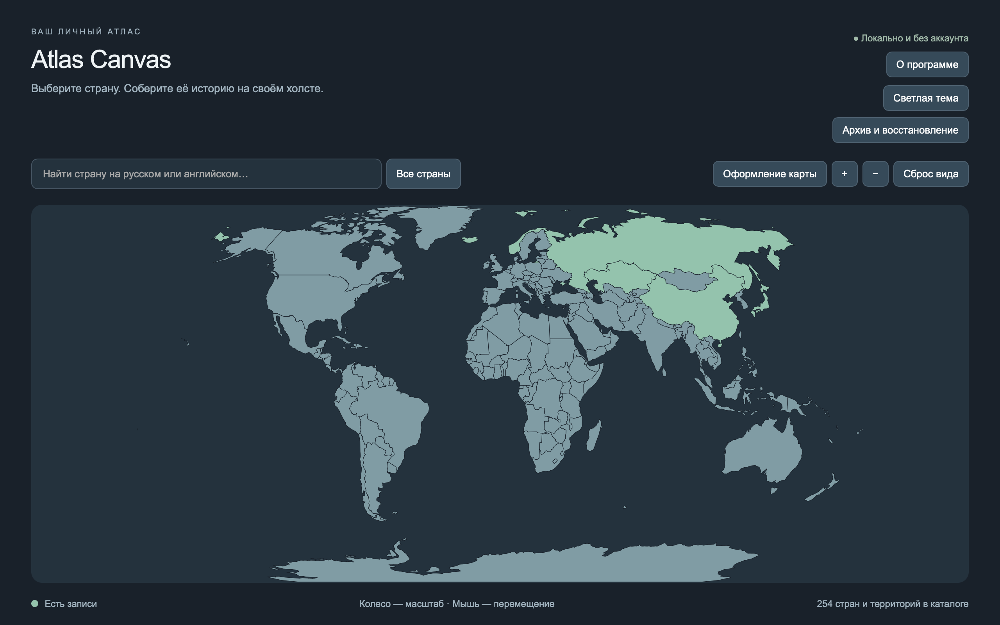

Click a country to open its canvas. Search by its Russian or English name, or use **All countries** for small countries that are hard to click. In search results, the name opens its canvas; **Show on map** zooms to it.

Countries with records have a different fill color. Scroll to zoom, drag to move the map, and use **Reset view** for the overview. **Map appearance** changes its colors and shimmer.

## The editor

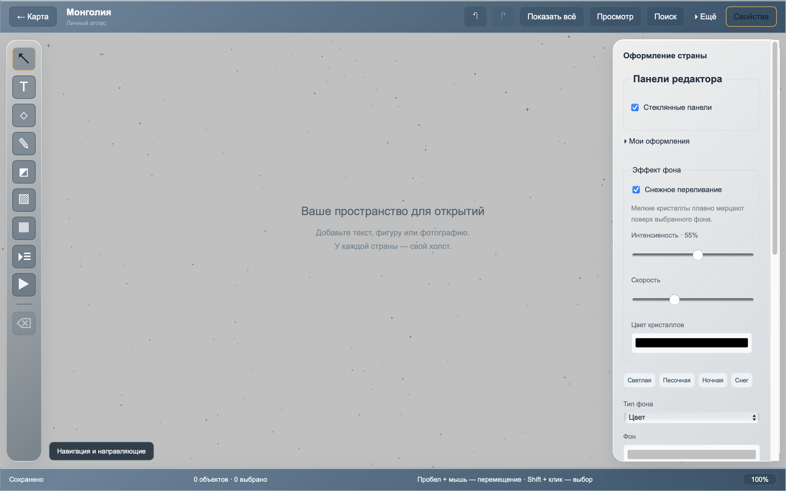

- **Left:** selection, text, shapes, drawing, photos, tables, expandable notes and media.
- **Right:** properties of the selection, or the country's appearance when nothing is selected.
- **Top:** return to map, Undo/Redo, search, **More** and view controls.
- **Bottom:** save status, object count and zoom.

Hover over a button for its tooltip. **Properties** hides/shows the right panel. **View** hides the editing tools; press Esc to return.

## Move, select and organize

| Action                      | How                                            |
| --------------------------- | ---------------------------------------------- |
| Zoom                        | Mouse wheel                                    |
| Pan                         | Drag empty space, or hold Space and drag       |
| Fit everything              | **Show all** or F                              |
| Zoom to 100%                | Click the percentage at the bottom, or press 1 |
| Select an object            | Click it                                       |
| Add/remove from a selection | Shift+click                                    |
| Select with a rectangle     | Shift+drag on empty space                      |
| Clear selection             | Esc                                            |

Drag photos, shapes and notes directly. **Drag a table, expandable note or player by its top title bar.** Selected objects have resize/rotation handles; exact values are available in Properties.

Use Undo at the top, or Cmd/Ctrl+Z. Redo restores an undone action. Undo history belongs to the currently open canvas session.

### Layers, groups and hiding

Properties can move objects forward/backward, duplicate them, lock them and group a selection. A group moves together; locking protects against accidental dragging.

**Layers** (Layers) lists objects and lets you hide them without deleting them. The right-click menu's **Arrange without overlap** (Arrange without overlaps) spreads materials apart; the action can be undone.

Copy/paste selected objects between countries within the same app session. Imported media references stay attached.

## Text and photographs

### Text

Press T or click Text. Double-click a note to edit. Enter inserts a new line; **Done** or Cmd/Ctrl+Enter finishes. Esc cancels the current text edit.

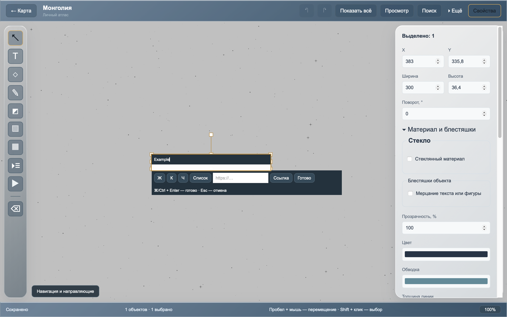

Properties control the whole note's font, size, color, alignment and background. To make only part of the text bold, italic or underlined, select that passage inside the text editor. Its toolbar also adds lists and links. Cmd/Ctrl+click a link in the finished note to open it.

Noto Sans and Noto Serif are bundled. **Add local font** imports a font file from your computer.

### Photographs

Use Add photo to select one or more images, or drag files onto the canvas. Move the photo and use the handles to resize it. Properties provide exact dimensions and rotation.

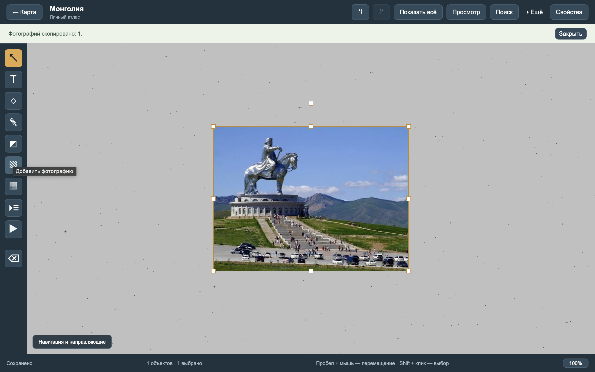

**Replace photo file** replaces the selected image. You can also open the imported original or reveal it in its folder. Moving the external source file does not break an already imported photograph.

### Crop

1. Select the photograph and click **Crop image**.
2. Drag the frame's corners to resize it, then move the frame over the part to keep.
3. Choose free proportions, 1:1, 4:3, 16:9 or 3:4, or enter percentages.
4. Click **Apply crop**. **Cancel** or Esc exits without changes.

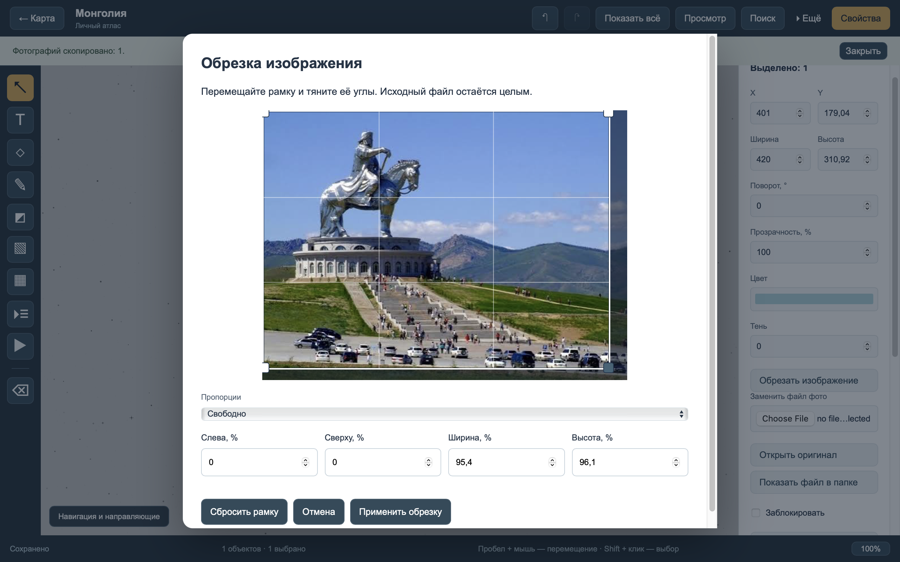

Cropping keeps the original intact. **Restore full image** restores it. Cropping is undoable and is retained in `.atlas`, PNG and PDF exports.

## Expandable notes

Click **Add expandable notes**. A block appears with **Details** and **Sources**. Click a heading to reveal its text area; click again to fold it.

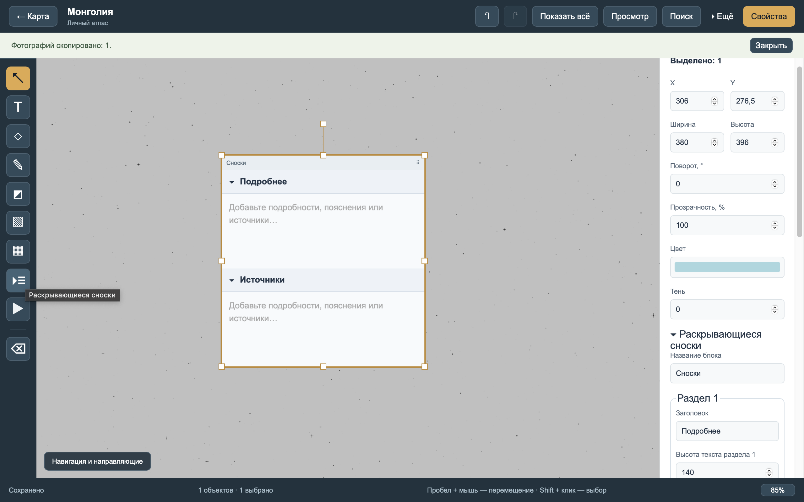

Properties rename the block and headings, add/remove sections and change each text area's height. Long text scrolls inside the section. Drag the block by its top title bar.

Text participates in autosave while you type. Cmd/Ctrl+Enter finishes input; Esc cancels the current edit. Search finds text inside folded sections, and choosing a result opens the matching section.

In View mode you can expand sections without changing their saved state. PNG/PDF use the saved state: expand the sections you want in editing mode before exporting. `.atlas` keeps all text, including folded content.

## Glass and sparkles

Select a note, shape, line or drawing, then open **Material and sparkles**.

- **Glass material** makes it translucent and blurs what is behind its letters or silhouette. Adjust blur, tint and density. A photo or colored backdrop makes the effect easier to see.
- **Text or shape shimmer** (Text/shape shimmer) adds stationary crystals with changing brightness. Adjust intensity, speed and color.
- Enable both together, or disable them to return to the object's regular styling.

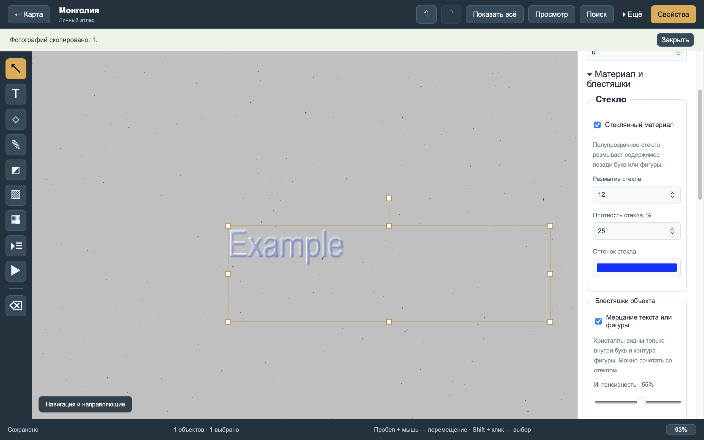

To make the editor panels translucent, clear the selection and enable **Country appearance → Glass panels**. This setting applies to that country.

System Reduce Motion makes shimmer static. PNG/PDF also contain a static frame; exported glass is an image of the blurred background and may differ slightly from the on-screen WebView. UI panels are excluded from canvas exports. `.atlas` keeps the editable material settings.

## Shapes and drawings

Open **Shapes**: rectangle, square, circle, ellipse, star, line or arrow. **Draw by dragging** lets you draw a shape with the mouse; otherwise the tool adds it automatically.

**Pen** (Pencil) draws freehand strokes. Its toolbar controls color, width and opacity. **Eraser** removes a complete stroke; Undo restores an accidental deletion.

## Tables

Click **Add table**, choose row/column counts and type into a cell. Properties add/remove rows and columns, resize them and change backgrounds, borders and typography.

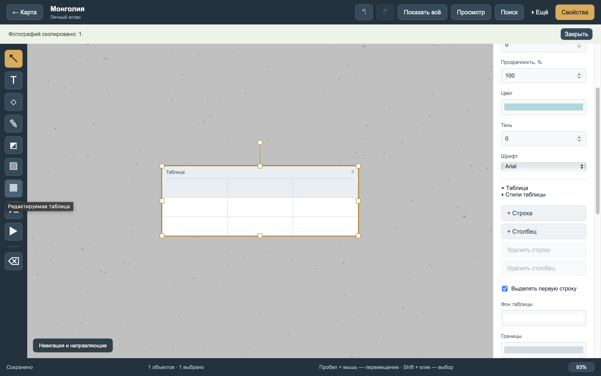

**Table styles** provides presets and saves your own style for reuse.

Select a cell, then use **Merge with cell to the right/below** (Merge with right/below). **Split cells** restores the grid. Covered cell text is preserved and reappears when split.

Drag the table by its title bar. Increase row height if text is clipped. Tables do not support formulas or calculations.

## Video, audio and links

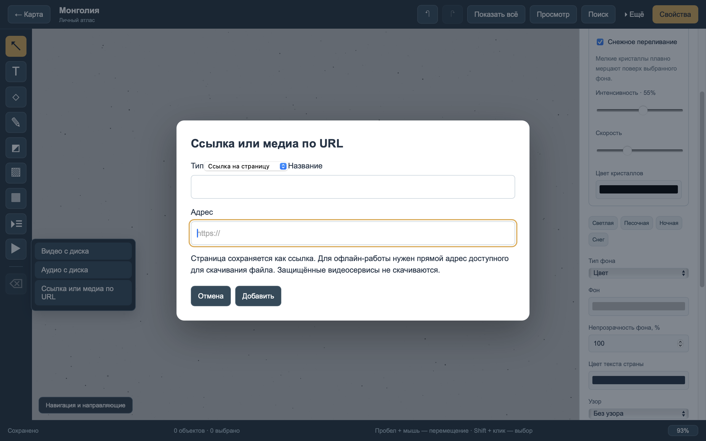

Open **Media and links**, choose video/audio and select a local file. Press the player's play button. Imported files work offline.

A link card stores a title and address, then opens the page in your browser. Visiting the page requires a connection.

The same menu can download an image, video or audio from its direct file URL. A video-service page is not a direct media file and may not work. Downloads can show progress and be cancelled.

**Replace media file**, open original and reveal in folder are available for selected media. If playback fails, try a system-supported format such as MP4 or WAV/MP3; codec support varies by OS.

## Background and snow shimmer

Clear the selection with Esc, then open **Properties → Country appearance**. Choose a preset or customize a solid color, gradient or background image. Adjust image placement, opacity, pattern and the country's default font.

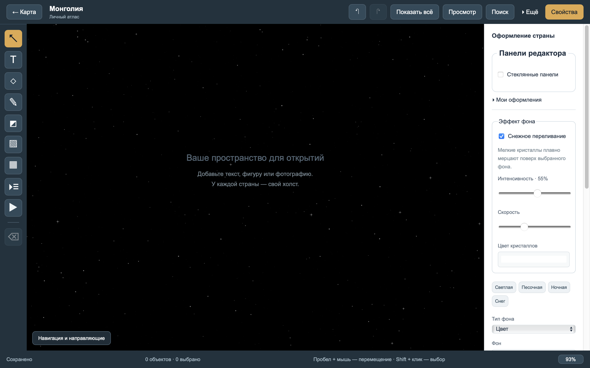

Enable **Snow shimmer** separately in **Background effect**. Intensity, speed and crystal color are adjustable. **Snow** supplies a matching base, but the shimmer works with other backgrounds too.

**My themes** saves a named appearance for another country. Changing one country does not change the rest. The app's light/dark interface theme is switched on the map screen.

## Search and navigation

**Search**, or Cmd/Ctrl+F, searches notes, tables, links and folded sections in the current country. Click a result to go to its object.

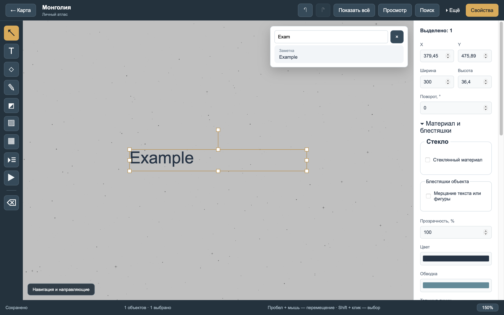

**Navigation and guides**, bottom left, contains the minimap, rulers and alignment guides. Enter a name and use **Save view** (Remember view) to bookmark a camera position.

F fits all objects. More also includes **Show selection** (Fit selection) and **Previous view**.

## Saving and backups

Wait for **Saved** at the bottom. An error message means a write needs attention; do not treat it as a successful save. The app waits for pending scene/settings writes when closing.

For a portable backup:

1. Open **Backup and restore** (Archive and restore).
2. Choose **Export entire atlas**, or **Export this country**.
3. Keep the `.atlas` file on another drive or computer.
4. To import, choose **Open archive to restore**, review its contents and click **Restore**.

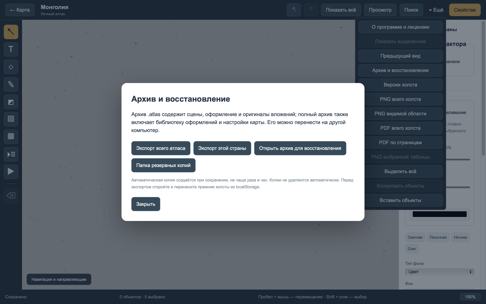

Existing countries are skipped by default. The replacement checkbox explicitly allows overwriting them; a backup is created before restoration. A full archive also includes shared theme/settings libraries and their media/font references. The public demo intentionally omits shared settings.

A full `.atlas` backup runs in the background after a changed canvas is saved, at most once per hour. Canvas saving does not wait for the archive. The backup folder keeps the latest **5 automatic copies**; older ones are deleted only after a new copy is saved successfully. Manual exports and pre-restore copies are kept. Unchanged canvases do not produce another automatic backup.

On the first successful automatic backup after updating, automatic copies beyond 5 will be permanently deleted, starting with the oldest. Move any copies you want to keep out of the backup folder beforehand.

Orphaned automatic-backup temporary files (`.auto-*.pending` and `.auto-*.partial`) from an interrupted archive are removed at the start of the next background task after a canvas save. If one removal fails, the app tries the others and continues creating the archive, reporting a separate cleanup warning. If a new copy was written but older copies could not be deleted, a cleanup warning appears; the new copy remains available and the folder may temporarily contain more than 5 copies.

**Saved** confirms the canvas write, not completion of its background backup. If you need a backup immediately, use **Export entire atlas** and wait for the successful export message.

**Canvas versions** in More lets you inspect and restore earlier saved states; they are separate from session Undo.

Do not move just the database without its media. `.atlas` is the convenient format for transferring everything together. There is no automatic cloud synchronization.

## PNG and PDF export

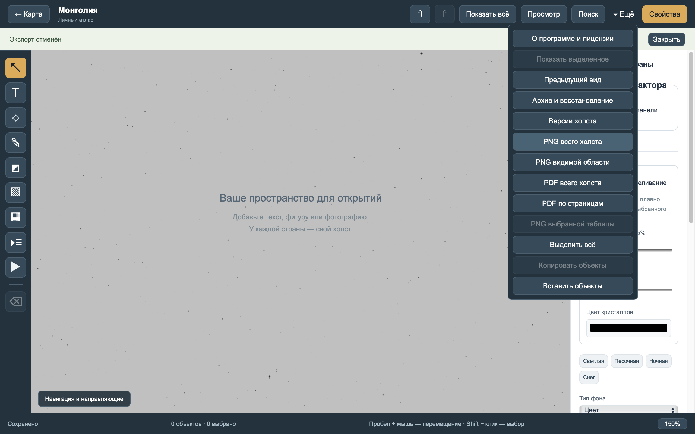

Open **More**: PNG of the entire canvas, PNG of the current viewport, PDF of the entire canvas or PDF split into pages. A selected table can also be exported to PNG.

The app asks where to save the result. Hidden objects are excluded. Crops and saved disclosure states are included; animations become static. Video/audio become cards in image/PDF exports; use `.atlas` to preserve the playable files.

PNG/PDF are for viewing and sharing. To continue editing on another computer, export `.atlas`.

## Frequently asked questions

**Do I need an account or internet?** No account is required. The map and locally imported files work offline. Visiting links or downloading remote files needs a connection.

**Will updating keep my records?** Regular builds use the same storage identifier. Export a backup first. Test apps with different identifiers have separate storage; transfer their records through `.atlas`.

**Why does an old version refuse my canvas?** Version 0.4 writes scene format 5. Versions 0.2/0.3 refuse it to avoid losing new features. Downgrading requires a pre-upgrade backup.

**Where did my objects go?** Press F, check Layers for hidden objects, or use search. Demo cover bookmarks deliberately show only part of a larger canvas.

**Does deleting an object erase its original file immediately?** No. Originals may still be needed by Undo, saved versions or other countries. Removing unused media automatically is not implemented.

**Why is a video silent or unavailable?** Check the player's mute/volume and system codec support. The imported original stays stored even if this OS cannot play it.

**Where do I report a problem?** [Open an issue](https://github.com/avdasich/atlas-canvas/issues) with your OS, app version and steps. Avoid sharing an archive with private records; the public demo is suitable for reproducible examples.
